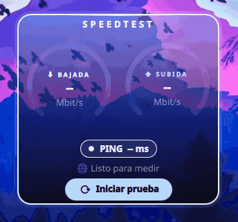
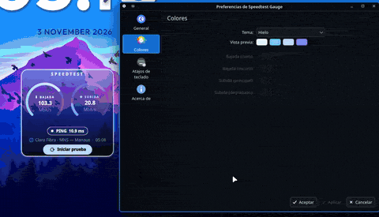

<h1 align="center">⚡ Speedtest Gauge</h1>

  <b>A glassy Plasma 6 widget that measures your internet speed with live animated gauges.</b>

  

  
  
  

---

## ✨ Features

- **Live gauges**: download and upload fill in real time while the test runs
- **Ping with quality color**: it changes color depending on how good your latency is
- **Server name and last test time** shown right in the widget
- **5 color themes** plus a fully **custom** option
- **Settings page**: fixed server, gauge scale and automatic tests
- **Card tab**: 5 materials (Tint, Glass, Liquid glass, Solid, Atmosphere), glass tint, opacity, corner radius, shadow, glass edge and compositor blur
- Compact, glass-style design that looks good on any wallpaper

## 🎨 Themes

Open the widget settings (right click → *Configure Speedtest Gauge…*) and go to the **Colors** tab. Pick a theme from the list and press **Apply**: the widget changes instantly.

  

Each theme uses four colors: two for **download** (light and dark) and two for **upload** (main and gradient).

| Theme | Download | Upload |
|---|---|---|
| **Req8939** (default) |  `#27D0F9`  `#0882D3` |  `#E0690C`  `#FFB347` |
| **Neon Magenta** |  `#FF5CE1`  `#8A2BE2` |  `#7DF9FF`  `#2F80ED` |
| **Amazonas** |  `#3DFFA2`  `#0B8F5A` |  `#FFD93D`  `#FF9F1C` |
| **Fire** |  `#FFD93D`  `#FF9F1C` |  `#FF4D4D`  `#B3123B` |
| **Ice** |  `#E6F7FF`  `#7FC8F8` |  `#BFD9FF`  `#6C8EF5` |
| **Custom** | your choice | your choice |

> 💡 Choose **Custom** in the theme list to unlock the four color buttons and pick your own colors.

## ⚙️ Settings

In the **General** tab:

| Option | What it does |
|---|---|
| **Server ID** | Always test against the same server. Leave empty for automatic. List IDs with `ookla-speedtest -L` |
| **Gauge max speed** | The speed (Mbit/s) at which the arc is 100% full. Set it close to your plan speed |
| **Auto test every** | Run a test automatically every X minutes. `0` = manual only |

## 🚀 Quick install

    git clone https://github.com/req8939/plasma-speedtest-gauge.git
    cd plasma-speedtest-gauge
    ./install.sh

The script installs the widget and downloads the official Ookla Speedtest CLI to `~/.local/bin/ookla-speedtest` if it is missing. To remove it: `./install.sh --uninstall`.

## 📦 Manual requirements

The widget uses the **official Ookla Speedtest CLI** (not `speedtest-cli`). Its license does not allow redistribution, so install it yourself:

    mkdir -p ~/.local/bin && cd /tmp
    curl -LO https://install.speedtest.net/app/cli/ookla-speedtest-1.2.0-linux-x86_64.tgz
    tar xzf ookla-speedtest-1.2.0-linux-x86_64.tgz speedtest
    mv speedtest ~/.local/bin/ookla-speedtest

The first run accepts the Ookla license automatically.

## 🚀 Install

**From the KDE Store:** right click the desktop → *Add Widgets…* → *Get New Widgets…* → search **Speedtest Gauge**.

**From file:**

    kpackagetool6 -t Plasma/Applet -i req8939.speedtest.plasmoid

**From source:**

    git clone https://github.com/req8939/plasma-speedtest-gauge.git
    cd plasma-speedtest-gauge
    kpackagetool6 -t Plasma/Applet -i .

Then right click the desktop → *Add Widgets…* → **Speedtest Gauge**.

## 🌍 Translations

The widget is written in English and translated through a plain dictionary in `contents/ui/strings.js`. Currently available: **English** (source), **Español** and **Português (Brasil)**. The language can be set to *Auto* (follows the system) or forced in the settings.

To add or fix a translation:

1. Open `contents/ui/strings.js`.
2. Copy the `"es"` block, rename it to your language code (e.g. `"fr"`) and translate the values on the right. Keep the English text on the left exactly as it is.
3. Open a pull request, or an issue with your translated block and I will add it.

Corrections to existing translations are very welcome.

> Thanks to [@Sadi58](https://github.com/Sadi58) for the original English translations and for the multilingual suggestion.

## 📄 License

GPL-2.0-or-later
